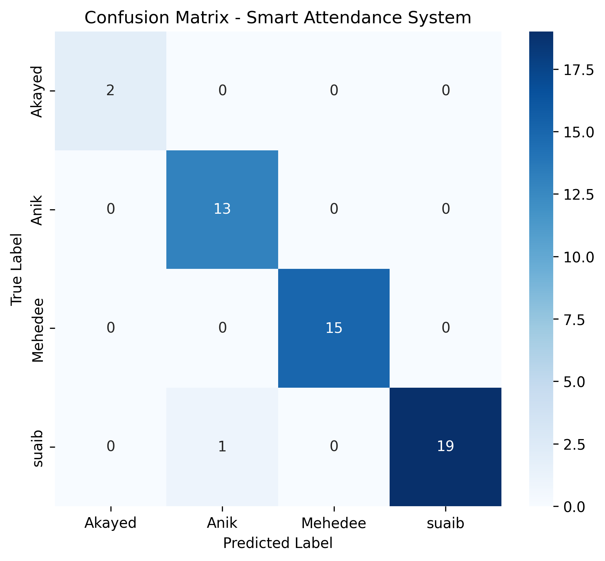

# Smart Attendance System Using Face Recognition

An experimental Python attendance project combining **two approaches**: HOG features with k-nearest neighbors (KNN), and face embeddings with nearest-match recognition. The project includes scripts for training, image prediction, webcam recognition, attendance recording, and evaluation.

This repository contains **source code and aggregate evaluation results only**. It does not include anyone's facial images, biometric embeddings, trained models, or attendance records.

## Methods and components

| Component | Implementation |
| --- | --- |
| HOG + KNN | Extract HOG features from grayscale images and train a KNN classifier. |
| Raw-pixel KNN baseline | Train KNN on resized grayscale image pixels. |
| Face embeddings | Use `face_recognition` to encode known faces and find nearest matches. |
| Attendance | Record recognized names and attendance status in local CSV files. |
| Webcam | OpenCV webcam preview with matched face labels. |

The `face_recognition` library uses pretrained facial recognition components; this repository does **not** train a ResNet model from scratch. The HOG/KNN pipeline and face-embedding pipeline are separate experiments.

## Historical result

The supplied confusion matrix records **49 correct predictions out of 50 observations (98.0% matrix accuracy)** across four named classes. This is a summary of recorded predictions, **not a verified independent test-set accuracy**. The original evaluation script used the same dataset directory that was used for enrollment encodings, so its reported scores can be optimistic. The sample count is limited and class sizes are uneven.



Regenerate the aggregate figure with `python src/confusion_matrix.py`. This does not require facial images.

## Repository structure

```text
src/
  attendance.py             # Batch attendance using HOG/KNN model
  webcam_attendance.py      # Live recognition using face embeddings
  encode_faces.py           # Create private face embeddings locally
  evaluate_model.py         # Evaluate on separately provided hold-out images
  train_custom_hog.py       # HOG/KNN on local labeled faces
  train_knn_hog.py          # Multi-folder HOG/KNN experiment
  train_knn_all.py          # Multi-folder raw-pixel KNN baseline
  predict_image.py          # Predict one local image with raw-pixel KNN
  check_downloaded_dataset.py
  confusion_matrix.py
results/
  confusion_matrix.png
requirements.txt
.gitignore
```

## Setup

1. Use a supported Python environment and install dependencies: `pip install -r requirements.txt`. The `face-recognition` package depends on `dlib`, which may require additional system build tools.
2. Run commands from the **repository root**. Scripts refer to local folders such as `dataset/`, `models/`, and `attendance_records/`.
3. Place **consented, locally stored** face images under `dataset/<person_name>/`. Do not commit these folders.
4. To build private embeddings, run `python src/encode_faces.py`. This creates `models/face_encodings.pkl` locally.
5. For live webcam attendance, run `python src/webcam_attendance.py` on a computer with a functioning camera. Generated CSV files are stored locally and ignored by Git.
6. For a HOG/KNN attendance model, run `python src/train_knn_hog.py` after arranging the local dataset directories expected by that script, then run `python src/attendance.py` with local images in `Raw_datasets/today_class/`.
7. For a **new** evaluation, use separate images under `dataset_eval/<person_name>/` and run `python src/evaluate_model.py`. Do not reuse enrollment images in evaluation.

`predict_image.py` expects a local image path (`TEST_IMAGE_PATH`) and the separately trained raw-pixel KNN model. These are not included in this repository.

## Privacy and limitations

- No personal face photos, face embeddings, attendance CSVs, or model pickle files are distributed.
- A model trained on private data cannot run without separately obtaining appropriate consented data and retraining locally.
- Python pickle and joblib files can execute code when loaded. Only load model files created and trusted locally.
- The provided historical confusion matrix is not proof of generalization to new people, lighting, camera types, or independent test images.
- Webcam prediction is a prototype. It does not include liveness/anti-spoofing, consent management, or access-control safeguards.
- Accuracy from a small, non-independent dataset should not be used to justify real-world automated attendance decisions without further testing.

## Reproducibility

The original scripts are included as a portfolio reference, with personal dataset paths and non-English UI strings cleaned up. These scripts have been checked for Python syntax; training and live recognition have **not** been rerun for this publication. No new performance numbers are claimed.
